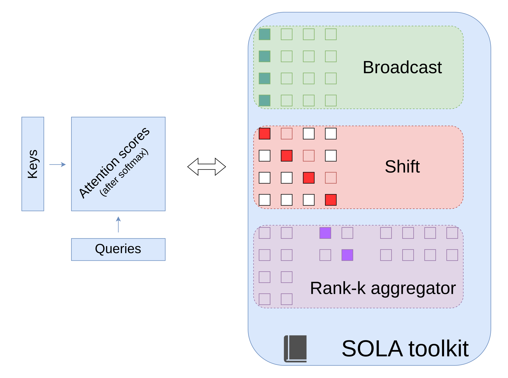

# SOLA: A Structured Operator Library for Attention in Pretrained Vision Transformers

<p align="center">
  <a href="https://nips.cc/virtual/2026/loc/paris/poster/149135"></a>
  
  
  
  <a href="LICENSE"></a>
</p>

Code and result files for the NeurIPS 2026 paper by Enzo Tartaglione (Télécom Paris, Institut
Polytechnique de Paris, CNR-ISASI) and Vito Paolo Pastore (University of Genoa, Istituto Italiano di
Tecnologia).
Paper and poster: [NeurIPS 2026 page](https://nips.cc/virtual/2026/loc/paris/poster/149135).

<p align="center">
  
</p>
<p align="center"><em>The softmax(QK<sup>T</sup>) attention-score matrix of a trained head is replaced, in place, by one of
three closed-form operators: broadcast, shift and rank-k aggregator.</em></p>

SOLA replaces attention heads of a frozen timm ViT with closed-form operators, without training:
a fixed 2D kernel for shift heads (Proposition 1), a per-image broadcast row for fixed-target
heads (Proposition 2) and a per-image rank-k approximation of the attention matrix (Proposition 3,
with k chosen per head in Corollary 3.1). Per-head diagnostics computed on a small calibration
batch assign each head to an operator.

## Installation

```
pip install -r requirements.txt
```

The release was tested with Python 3.10, PyTorch 2.11 and timm 1.0.27 on RTX 2080, RTX 2080 Ti and
Tesla P100 cards, and the Triton scripts on RTX 2080 Ti and RTX 3090 cards.

## Data

| Data | Used by | Default location |
|---|---|---|
| ImageNet-1k val, ImageFolder layout (`val/<wnid>/*.JPEG`) | most experiments | `data/imagenet/val`, or `--imagenet-val-dir` / `--val-dir` |
| tiny-ImageNet val split | taxonomy, residuals, shift and kernel controls | downloaded on first use (`zh-plus/tiny-imagenet` via `datasets`) |
| COCO val2017 | BLIP cross-attention, LLaVA captions, taxonomy stability | `--coco-dir`, `--coco-val` |
| COCO train2017 and COCO-Stuff pixel maps | segmentation probe | `--coco-train-*`, `--coco-val-*` |
| ImageNet-1k train and val (`IMAGENET_ROOT/train`, `IMAGENET_ROOT/val`) | training from scratch | `--data-dir` |

## Layout

```
sola/            library: loaders and attention capture, per-head diagnostics, substitutes
experiments/     one script per experiment, figure scripts, Triton kernels, training scripts
results/         JSON files behind the tables of the paper
results/emergence/   per-epoch analyses of the two models trained from scratch (Sec. 4.2)
checkpoints/     epoch-99 weights of those two models
tests/           unit tests and a smoke test
assets/          figure of this README
reproduce.py     end-to-end example on one backbone
```

## Quick start

```
python reproduce.py --val-dir data/imagenet/val
python reproduce.py --val-dir data/imagenet/val --fresh --model deit_tiny_patch16_224
```

The first command reads the heads of ViT-B/16 ImageNet-21k FT from `results/` and prints the
top-1 change of each substitution on the first 9,984 val images. With `--fresh` the taxonomy is
recomputed on calibration images instead.

```
python tests/test_kernel_substitution.py
python tests/test_operator_taxonomy.py
bash tests/smoke_test.sh data/imagenet/val
```

The smoke test runs every script on a few images to check that it executes.

## Tables and result files

Table numbers follow the camera-ready version. Scripts are in `experiments/`, result files in `results/`.

| Table | Content | Script | Result files |
|---|---|---|---|
| 1 | SOLA summary | rows of Tables 2, 7, 8, 10 | see those tables |
| 2 | Coverage and full substitution | `svd_spectrum_diagnostic.py`, `adaptive_rank_eval.py`, `zeroshot_siglip_eval.py` | `adaptive_rank_*`, `svd_spectrum_*`, `zeroshot_siglip_*` |
| 3, 4, 22 | Shift controls, ViT-B and DeiT-Tiny | `shift_substitution_controls.py` | `vit_b_controls_v2`, `deit_tiny_controls_v2` |
| 5, 29 | Category counts | `operator_taxonomy.py`, `redistribute_other.py` | `taxonomy_*` |
| 6 | Categories at L scale | `operator_taxonomy.py` | `taxonomy_clip_L` |
| 7, 23 | Kernel substitution | `kernel_substitution_controls.py` | `kernel_*` |
| 8, 9 | Broadcast and image-mean | `broadcast_controls.py`, `attn_matrix_controls.py` | `broadcast_*`, `image_mean_*` |
| 10 | Rank-10 | `rank_k_controls.py` | `rank10_*` |
| 11 | Per-class behaviour | `behavioral_mapping.py`, `analyze_behavioral.py` | `behavioral_*` |
| 12 | Residual-stream faithfulness | `faithfulness_probe.py` | `faithfulness_*` |
| 13 | Triton wall-clock | `fused_wallclock.py` | `wallclock_*` |
| 14 | Energy | `energy_benchmark.py` | `energy_*` |
| 15 | Path patching | `circuit_composition.py`, `circuit_composition_full.py` | `circuit_composition_*` |
| 16 | Corruptions | `substitution_robustness.py` | `robustness_*` |
| 17 | Rank-k at `other` heads, MAE-Tiny | `mae_other_rank_test.py` | `mae_other_rank` |
| 18 | Rank-30 and rank-50 at `other` heads | `other_rank_sweep.py` | `other_rank_sweep` |
| 19 | BLIP cross-attention | `cross_attention_eval.py` | `cross_attention_blip_n100`, `taxonomy_blip_crossattn` |
| 20 | LLaVA captions | `llava_substitution_eval.py` | `llava_substitution` |
| 21, 31 | Shift fingerprints | `operator_taxonomy.py`, `visualize_heads.py` | `taxonomy_*` |
| 24 | tau sweep, DINOv2 | `tau_sweep.py` | `tau_sweep_dinov2` |
| 25 | Each operator at its gated pool | `broadcast_controls.py`, `rank_k_controls.py`, `other_rank_sweep.py` | `broadcast_*`, `rank10_*`, `other_rank_sweep` |
| 26, 33 | Rank curves | `rank_curve_near_global.py` | `rank_curve_*` |
| 27 | Verified heads | `fill_cells.py` and the group tests above | `fill_*` and Tables 7, 8, 10 |
| 28 | COCO taxonomy stability and segmentation probe | `coco_taxonomy_stability.py`, `coco_seg_probe.py` | `taxonomy_stability_coco_vitb`, `segprobe_coco_vitb` |
| 30 | Threshold ablation | `threshold_ablation.py` | reads `taxonomy_*` |
| 32 | Singular value spectrum | `svd_spectrum_diagnostic.py` | `svd_spectrum_*` |
| 34 | Triton kernel tests | `test_triton_shift.py` | printed |
| Sec. 4.1 | Translation-equivariance and per-image shifts | `fixed_target_diagnostic.py`, `per_image_shift_diagnostic.py` | `fixed_target_*`, `per_image_shift_*` |
| Sec. 4.2 | Training from scratch | `train_deit_tiny.py`, `train_mae_tiny.py`, `analyze_checkpoint.py` | `emergence/`, `checkpoints/` |

Figures: `make_taxonomy_figure.py`, `make_escape_mass_figure.py` (input from `escape_mass_sweep.py`,
`results/escape_comparison.json`), `make_operator_map_figure.py`, `make_circuit_composition_figure.py`,
`make_comparison_figure.py` (training from scratch) and `extract_teaser_assets.py` (overview figure).

## Commands

`M` is a timm model name with its tag, `T` the Stage-1 taxonomy file of that model
(`results/taxonomy_X_with_other.json`) and `D` its `fixed_target_*` file. The stored group tests,
probes and rank curves were run on Stage 1; a Stage-2 file selects different near-global and
diffuse-local heads. Commands of experiments that were run without a job script are rebuilt from
the parameters stored in their result files.

Taxonomy, residuals and spectrum. `operator_taxonomy.py` writes the Stage-1 taxonomy, which leaves
some heads in an `other` class; `redistribute_other.py` keeps it as `taxonomy_*_with_other.json` and
rewrites `taxonomy_*.json` with Stage 2, which sends `other` heads with eff_rank_90 at most 40 to
near-global and the rest to diffuse-local. `escape_mass_sweep.py` writes the input of the
escape-mass figure.

```
python experiments/operator_taxonomy.py --model M --batches 4 --batch-size 32 --out results/taxonomy_X.json
python experiments/fixed_target_diagnostic.py --model M --taxonomy results/taxonomy_X.json --batches 4 --batch-size 32 --out results/fixed_target_X.json
python experiments/svd_spectrum_diagnostic.py --model M --taxonomy results/taxonomy_X.json --out results/svd_spectrum_X.json
python experiments/redistribute_other.py
python experiments/escape_mass_sweep.py --models deit_tiny_patch16_224 vit_base_patch16_224 vit_base_patch16_clip_224.openai --batches 8 --out-dir results
```

Group tests, with random-head and third controls. By default they evaluate 156 batches of 64: the
first 9,984 ImageNet val images, or with `--source tiny-imagenet` the 9,100 tiny-ImageNet images
that map to ImageNet-1k classes. Encoders without a classifier take `--metric cls-cos-sim`.

```
python experiments/kernel_substitution_controls.py --model M --taxonomy T --categories delta_shift soft_shift --source tiny-imagenet
python experiments/kernel_substitution_controls.py --model M --taxonomy T --categories delta_shift --source imagenet-val --batches 1000 --batch-size 50
python experiments/broadcast_controls.py --model M --taxonomy T --diag D [--category diffuse_local|near_global]
python experiments/attn_matrix_controls.py --model M --taxonomy T --diag D
python experiments/rank_k_controls.py --model M --taxonomy T --diag D --k-rank 10
python experiments/shift_substitution_controls.py --model vit_base_patch16_224 --shift-heads 1,10 2,6 2,3 3,1 --batches 156
python experiments/fill_cells.py --model M --op {shift,broadcast_diffuse,rank10_ng} --metric {top1,cossim} --n-cal 32 --n-eval 9984 --batch-size 32 --imagenet-val-dir data/imagenet/val
```

The DINOv2 cell of `fill_cells.py` used `--n-cal 8 --n-eval 2048 --batch-size 8`.

Full substitution (Table 2) and its tau sweep:

```
python experiments/adaptive_rank_eval.py --model M --taxonomy T --svd-spectrum S --batch-size 64 --n-eval 9984 --cls-cos-n 2048
python experiments/adaptive_rank_eval.py --model M --taxonomy T --svd-spectrum S --batch-size 64 --no-top1 --cls-cos-n 2048
python experiments/zeroshot_siglip_eval.py --batch-size 32 --n-eval 10000 --out results/zeroshot_siglip_adaptive.json
python experiments/zeroshot_siglip_eval.py --batch-size 32 --n-eval 10000 --tau 0.99 --out results/zeroshot_siglip_tau99.json
python experiments/tau_sweep.py --mode dinov2 --model vit_base_patch14_dinov2.lvd142m --imagenet-val-dir data/imagenet/val --n-cal 8 --n-eval 2048 --batch-size 16 --taus 0.90 0.93 0.95 0.97 0.99
```

`results/tau_sweep_dinov2.json` joins two runs: tau = 0.90 to 0.97 from a run stopped by its time
limit before tau = 0.99, whose calibration size was not recorded, and tau = 0.99 from the command
above with `--taus 0.99`. DINOv2 runs at 518 pixels in this mode.

Rank curves and the `other` pool:

```
python experiments/rank_curve_near_global.py --model M --taxonomy T --category near_global --metric top1 --ks 1 2 3 5 10 20 50 --n-batches 782 --batch-size 64 --imagenet-val-dir data/imagenet/val --out results/rank_curve_vitb_ng.json
python experiments/rank_curve_near_global.py --model M --taxonomy T --category other --metric {cls-cos,top1} --ks 10 30 50 100 150 196 --n-batches 156 --batch-size 64 --imagenet-val-dir data/imagenet/val --out results/rank_curve_X_other.json
python experiments/other_rank_sweep.py --eval-batch-size 64 --n-eval-batches-top1 782 --n-eval-batches-cos 156 --ks 30 50 --imagenet-val-dir data/imagenet/val --out results/other_rank_sweep.json
python experiments/mae_other_rank_test.py --ckpt checkpoints/mae_tiny_scratch_encoder_epoch99.pth --analysis-json results/emergence/mae_tiny/epoch_99.json --n-batches 156 --batch-size 64
```

Behaviour, faithfulness, path patching, corruptions:

```
python experiments/behavioral_mapping.py --model M --taxonomy T --diag D --out results/behavioral_X.json
python experiments/analyze_behavioral.py --input results/behavioral_X.json
python experiments/faithfulness_probe.py --model M --taxonomy T --diag D --batch-size 64 --out results/faithfulness_X.json
python experiments/circuit_composition.py --model M --taxonomy T --batch-size 64 --out results/circuit_composition_X.json
python experiments/circuit_composition_full.py --model M --taxonomy T --diag D --operator broadcast --r-thresh 0.4 --batch-size 64 --n-batches 4 --out results/circuit_composition_vitb_broadcast.json
python experiments/circuit_composition_full.py --model M --taxonomy T --diag D --operator rank10 --rank-k 10 --batch-size 64 --n-batches 4 --out results/circuit_composition_vitb_rank10.json
python experiments/substitution_robustness.py --model M --taxonomy T --diag D --max-batches 156 --corruptions clean,gauss_noise_0.05,gauss_blur_2,contrast_0.5 --out results/robustness_X.json
```

Speed and energy (the Triton path needs a CUDA GPU):

```
python experiments/test_triton_shift.py
python experiments/fused_wallclock.py --model M --taxonomy T --broadcast-json results/broadcast_X.json --batch-size 32 --n-warmup 30 --n-runs 200 --source synthetic --n-acc-batches 0 --dtype fp32 --out results/wallclock_X.json
python experiments/energy_benchmark.py --model deit_tiny_patch16_224 --taxonomy results/taxonomy_deit.json --broadcast-json results/broadcast_deit.json --batch-size 128 --warmup-s 30 --run-s 60 --dtype fp32 --out results/energy_deit_fp32.json
```

Beyond ImageNet classification:

```
python experiments/cross_attention_eval.py --coco-dir data/coco/val2017 --n-images 100 --out results/cross_attention_blip_n100.json
python experiments/llava_substitution_eval.py --llava-id llava-hf/llava-1.5-7b-hf --taxonomy results/taxonomy_clip_L.json --coco-val data/coco/val2017 --n-images 50 --max-new-tokens 30 --out results/llava_substitution.json
python experiments/coco_taxonomy_stability.py --imagenet-val-dir data/imagenet/val --coco-dir data/coco/val2017 --n-cal 32 --n-repeats 8
python experiments/coco_seg_probe.py --coco-train-img data/coco/train2017 --coco-train-mask data/coco/stuff_train2017_pixelmaps --coco-val-img data/coco/val2017 --coco-val-mask data/coco/stuff_val2017_pixelmaps --n-train 3000 --n-val 500 --n-cal 32 --batch-size 16 --epochs 5
```

Training from scratch (Sec. 4.2) and the per-epoch analysis:

```
python experiments/train_deit_tiny.py --data-dir IMAGENET_ROOT --output output/deit_tiny_scratch --epochs 100 --batch-size 256 --workers 12 --lr 5e-4 --weight-decay 0.05 --warmup-epochs 5 --ckpt-every 5
python experiments/train_mae_tiny.py --data-dir IMAGENET_ROOT --output output/mae_tiny_scratch --epochs 100 --batch-size 256 --workers 12 --lr 1.5e-4 --weight-decay 0.05 --warmup-epochs 5 --ckpt-every 5
python experiments/analyze_checkpoint.py --model deit_tiny_patch16_224 --checkpoint C --imagenet-val-dir data/imagenet/val --batch-size 32 --n-batches 4 --K 5 --out results/emergence/deit_tiny/epoch_N.json
python experiments/analyze_checkpoint.py --model vit_tiny_patch16_224 --checkpoint C --imagenet-val-dir data/imagenet/val --batch-size 32 --n-batches 4 --K 5 --out results/emergence/mae_tiny/epoch_N.json
```

## Checkpoints

`checkpoints/` holds the epoch-99 weights of the two models trained from scratch in Sec. 4.2,
without optimizer state: `deit_tiny_scratch_epoch99.pth` (a `deit_tiny_patch16_224`) and
`mae_tiny_scratch_encoder_epoch99.pth` (the ViT-Tiny encoder of the MAE, loadable into
`vit_tiny_patch16_224`). Each file is a dict with the weights under `model`, the epoch and the
training arguments. The analyses in `results/emergence/*/epoch_99.json` are recomputed from these
files by the `analyze_checkpoint.py` commands above.

## Citation

```
@inproceedings{tartaglione2026sola,
  title     = {{SOLA}: A Structured Operator Library for Attention in Pretrained Vision Transformers},
  author    = {Tartaglione, Enzo and Pastore, Vito Paolo},
  booktitle = {Advances in Neural Information Processing Systems},
  year      = {2026}
}
```

## License

MIT, see `LICENSE`.
